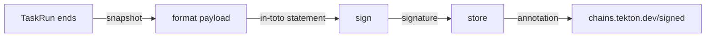

# How Tekton Chains Works

A build system can be attacked in many places: the source, the build steps, the machine that runs them, the registry that stores the result. Supply-chain Levels for Software Artifacts (SLSA, said "salsa") is a security framework that lists those places and the controls against them. One of its main controls is provenance: a signed record, written by the build system itself, that says which artifact was built, by which build, from which inputs. This part shows how Tekton Chains writes that record for Tekton, and why you must check its work.

## What the Chains controller does

Tekton Chains is installed from its own release manifest, next to Tekton Pipelines. In the playground it is already installed with this command:

<!-- astrona:playground:renew -->

```sh
kubectl apply -f https://infra.tekton.dev/tekton-releases/chains/previous/v0.29.9/release.yaml
```

The release creates the namespace `tekton-chains` with one Deployment, `tekton-chains-controller`, an empty Secret `signing-secrets`, an empty ConfigMap `chains-config`, and the ConfigMap `chains-info` with the version. Check that the controller runs and which version it is:

```sh
kubectl get pods -n tekton-chains
tkn version
```

The pod is `Running`, and `tkn version` prints a `Chains version: v0.29.9` line next to the Pipelines version. `tkn` reads that version from `chains-info`.

The Chains controller watches every TaskRun and PipelineRun in the cluster. It does nothing while a run is going. When a run's `Succeeded` condition turns `True`, the controller takes a snapshot of the finished run and works through four steps:



The diagram shows the order: the controller formats the run into a payload, signs it with the configured signer, stores payload and signature in the configured storage backends, and last writes the annotation `chains.tekton.dev/signed` on the run.

This is why Chains is called non-blocking. The TaskRun already ended before Chains starts, so Chains can never slow down, stop or fail a build. The other side of the same coin: a signing problem never shows on the run's status. You find it only in the Chains annotations, the controller log, and the storage.

## Run a Task with no key

Chains starts with an empty `signing-secrets`, so it has nothing to sign with yet. See what happens anyway. Save this as `task-hello.yaml`:

```yaml
apiVersion: tekton.dev/v1
kind: Task
metadata:
  name: hello
  namespace: starfleet
spec:
  params:
    - name: crew
      type: string
      default: bridge
  results:
    - name: greeting
      description: The greeting that was printed
  steps:
    - name: greet
      image: busybox:1.37.0
      script: |
        #!/bin/sh
        printf 'Hello, %s!' "$(params.crew)" | tee "$(results.greeting.path)"
```

Apply it, and start a run with `tkn`:

```sh
kubectl apply -f task-hello.yaml
tkn task start hello -n starfleet --use-param-defaults --prefix-name hello-nokey --showlog
```

Then check the result. The second command reads the controller log for the signer:

```sh
kubectl get taskruns -n starfleet -o custom-columns='NAME:.metadata.name,SIGNED:.metadata.annotations.chains\.tekton\.dev/signed'
kubectl logs -n tekton-chains deploy/tekton-chains-controller | grep -i signer
```

The run shows `SIGNED` as `true`. The log tells another story: the controller found no private key (`no valid private key found, looked for: [x509.pem, cosign.key]`) and logged that no `x509` signer is configured. In Tekton Chains v0.29.9, a missing signer is not an error: the controller skips the signing step and still marks the run as signed. Remember this case; it is the most common reason for "signed" runs without signatures.

## Give Chains a cosign key

cosign is the signing tool of the Sigstore project. Chains can sign with a cosign key pair, an x509 key, a key in a key management service (KMS), or keylessly. The simplest is a cosign key pair in `signing-secrets` with three keys: `cosign.key` (the encrypted private key), `cosign.password` (the password that decrypts it) and `cosign.pub` (the public key that others use to verify).

`cosign` can write that Secret itself through the `k8s://` key reference. Open a shell in the workstation pod, whose ServiceAccount may write Secrets in `tekton-chains`:

```sh
kubectl exec -it -n workstation deploy/workstation -- sh
COSIGN_PASSWORD=lab-only-password cosign generate-key-pair k8s://tekton-chains/signing-secrets
exit
```

`COSIGN_PASSWORD` sets the password, so `cosign` does not prompt. It reports that it created or updated the Secret, writes `cosign.pub` into the current folder of the pod, and marks the Secret immutable. To replace the key later, you delete the Secret and create it again.

The Chains controller reads the key from a Secret volume each time it signs. The kubelet refreshes that volume within about a minute, so wait a minute, or restart the controller to use the key at once:

```sh
kubectl rollout restart deployment/tekton-chains-controller -n tekton-chains
kubectl rollout status deployment/tekton-chains-controller -n tekton-chains
```

## Read the signed provenance

With the default `chains-config`, Chains formats a TaskRun as an in-toto statement and stores it with the `tekton` storage backend, which means as annotations on the TaskRun itself. An in-toto statement is a JSON document with a `subject` (the artifacts it is about), a `predicateType` and a `predicate` (here the SLSA provenance). Run the Task again:

```sh
tkn task start hello -n starfleet --use-param-defaults --prefix-name hello-signed --showlog
```

Then check the result. The annotations are named after the run's UID, so read the UID of the newest run first:

```sh
RUN=$(kubectl get taskruns -n starfleet --sort-by=.metadata.creationTimestamp -o jsonpath='{.items[-1:].metadata.name}')
UID_OF_RUN=$(kubectl get taskrun "$RUN" -n starfleet -o jsonpath='{.metadata.uid}')
kubectl get taskrun "$RUN" -n starfleet -o yaml | grep 'chains.tekton.dev/'
kubectl get taskrun "$RUN" -n starfleet -o jsonpath="{.metadata.annotations.chains\.tekton\.dev/payload-taskrun-$UID_OF_RUN}" | base64 -d; echo
```

The run now has `chains.tekton.dev/signed: "true"` and two new annotations: `chains.tekton.dev/payload-taskrun-<uid>` and `chains.tekton.dev/signature-taskrun-<uid>`. The payload decodes to an in-toto statement with `"predicateType":"https://slsa.dev/provenance/v0.2"`. Its predicate names the builder `https://tekton.dev/chains/v2`, the parameters, and the image of each step with its digest. The `subject` list is empty: this Task built no image, and Chains only signs artifacts it can identify. `tkn chain payload <taskrun>` and `tkn chain signature <taskrun>` read the same two annotations for you.

These are the defaults that produced this result; they all live in `chains-config` and are empty until you set them:

| Key | Default | Meaning |
| --- | --- | --- |
| `artifacts.taskrun.format` | `in-toto` | Payload format of TaskRun provenance (SLSA v0.2) |
| `artifacts.taskrun.storage` | `tekton` | Store TaskRun provenance as annotations on the TaskRun |
| `artifacts.taskrun.signer` | `x509` | Sign with the key in `signing-secrets` (cosign or x509) |
| `artifacts.oci.storage` | `oci` | Store image signatures in the registry |
| `transparency.enabled` | `false` | No upload to a transparency log |

You can now say what Chains does with a finished run, give it a key, and read the provenance it stores on a TaskRun. Provenance on a TaskRun is useful, but the people who pull your image never see the TaskRun. The open question is how to put the signature and the provenance next to the image in the registry.

## Common pitfalls

> [!WARNING]
> - **Trusting `chains.tekton.dev/signed: "true"`.** Chains sets it even when it had no signer. Check the controller log and the stored signatures.
> - **Expecting Chains to sign an old run.** Chains handles each run once. A run that was marked before you added the key stays unsigned; start a new run.
> - **Editing an immutable Secret.** After `cosign generate-key-pair k8s://...`, the Secret cannot change. Delete it and create it again for a new key.
> - **Using the key at once.** The Secret volume refreshes after a delay. Restart the controller, or wait about a minute, before the next run.
> - **Forgetting `cosign.password`.** An encrypted `cosign.key` without the right password gives no signer, and again nothing is signed.
