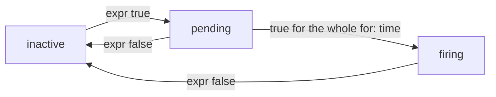

# Alert On Failed TaskRuns

A dashboard shows a problem only to someone who looks at it. An alert goes to the people on call, at the moment the problem starts. Prometheus evaluates alerting rules on its own schedule and marks an alert as firing when its condition is true; a separate program, Alertmanager, then sends it by e-mail, chat or paging. This part writes the alerting rules for Tekton and follows an alert through its states.

## How an alerting rule works

An alerting rule is a PromQL expression with a name. Prometheus evaluates it every `evaluation_interval`. Each series the expression returns is one active alert; when it returns nothing, the alert is inactive. A rule has these fields:

| Field | Meaning |
| --- | --- |
| `alert` | The name of the alert, which becomes the label `alertname` |
| `expr` | The PromQL condition. The alert is active while it returns at least one series |
| `for` | How long the condition must stay true before the alert fires. Until then the alert is `pending` |
| `labels` | Extra labels, such as `severity`, that Alertmanager uses to route the alert |
| `annotations` | Text for people, such as `summary` and `description` |

An alert is `inactive` while the expression returns nothing, `pending` while it is true for less than `for`, and `firing` after that. Without `for`, it goes straight to `firing`.



The diagram shows the three states and the moves between them; a rule without `for` skips `pending`.

Rules live in rule files, grouped by name, and the Prometheus configuration lists the files under `rule_files`. In a cluster with the Prometheus Operator, a `PrometheusRule` resource holds the same groups.

## Write the Tekton rules

Two rules cover the failures from the start of this module. `TektonTaskRunFailed` fires when the controller has counted at least one failed TaskRun. `TektonControllerDown` fires when Prometheus could not scrape the controller for two minutes. The new version of the ConfigMap keeps the scrape job and fills `tekton-rules.yml`.

<!-- astrona:playground:renew -->

Save this as `configmap-prometheus-config.yaml`:

```yaml
apiVersion: v1
kind: ConfigMap
metadata:
  name: prometheus-config
  namespace: monitoring
data:
  prometheus.yml: |
    global:
      scrape_interval: 15s
      evaluation_interval: 15s
    rule_files:
      - /etc/prometheus/tekton-rules.yml
    scrape_configs:
      - job_name: prometheus
        static_configs:
          - targets: ["localhost:9090"]
      - job_name: tekton-pipelines-controller
        static_configs:
          - targets: ["tekton-pipelines-controller.tekton-pipelines.svc:9090"]
  tekton-rules.yml: |
    groups:
      - name: tekton
        rules:
          - alert: TektonTaskRunFailed
            expr: sum(tekton_pipelines_controller_taskrun_total{status="failed"}) > 0
            labels:
              severity: warning
            annotations:
              summary: A TaskRun failed
          - alert: TektonControllerDown
            expr: up{job="tekton-pipelines-controller"} == 0
            for: 2m
            labels:
              severity: critical
            annotations:
              summary: Prometheus cannot scrape the Tekton Pipelines controller
```

Apply it and restart Prometheus:

```sh
kubectl apply -f configmap-prometheus-config.yaml
kubectl rollout restart deployment/prometheus -n monitoring
kubectl rollout status deployment/prometheus -n monitoring
```

Then check which rules Prometheus loaded and their state:

```sh
kubectl exec -n monitoring deploy/client -- sh -c 'curl -s http://prometheus.monitoring:9090/api/v1/rules | jq -r ".data.groups[].rules[] | .name + \" \" + .state"'
```

Both rules are listed. `TektonControllerDown` is `inactive`. `TektonTaskRunFailed` is already `firing` if the controller counted the failed run of `nightly-check` from earlier; otherwise it is `inactive`.

The first rule uses the plain counter on purpose. A rule with `increase(...[10m]) > 0` looks more natural, but a counter series that is created with the value `1`, which is what happens at the first failure after a controller start, has no increase inside its window, so that rule would miss the very first failure. The plain counter never misses it, but stays `firing` until the controller restarts. Teams often use the plain counter for a test cluster and `increase` with a longer window for production.

## Watch the alerts move

Fail a run, then read the alerts:

```sh
tkn task start nightly-check -n starfleet -p outcome=fail --showlog
kubectl exec -n monitoring deploy/client -- sh -c 'curl -s http://prometheus.monitoring:9090/api/v1/alerts | jq -r ".data.alerts[] | .labels.alertname + \" \" + .state + \" \" + .labels.severity"'
```

Within about 30 seconds, one scrape and one evaluation, the second command prints `TektonTaskRunFailed firing warning`. Now stop the controller to see `for` at work, and start it again after about three minutes:

```sh
kubectl scale deployment tekton-pipelines-controller -n tekton-pipelines --replicas=0
kubectl exec -n monitoring deploy/client -- sh -c 'curl -s http://prometheus.monitoring:9090/api/v1/alerts | jq -r ".data.alerts[] | .labels.alertname + \" \" + .state"'
kubectl scale deployment tekton-pipelines-controller -n tekton-pipelines --replicas=1
```

Run the second command a few times before the third. A minute after the scale-down, `TektonControllerDown` is `pending`; two minutes later it is `firing`. `TektonTaskRunFailed` disappears from the list while the controller is down, because without a scrape its series is gone; after the restart the counter starts again at zero. In a real setup, Alertmanager would now send the `critical` alert to the people on call, and the `warning` alert to the team's chat.

You can now write alerting rules for Tekton, load them, and follow an alert through `inactive`, `pending` and `firing`. With the metrics endpoint, the scrape job and the rules, you know all three places where a silent alert can come from.

## Common pitfalls

> [!WARNING]
> - **A rule file that `rule_files` does not name.** Prometheus ignores it without an error.
> - **A selector that never matches.** `status="failure"` returns nothing, so the alert is always `inactive`. Test every alert with a real failure.
> - **`increase` on a new series.** The first failure after a controller restart creates the series at `1`, and `increase` sees no change.
> - **A YAML error in a rule file.** Prometheus does not start with a broken file. Read `kubectl logs -n monitoring deploy/prometheus`.
> - **Alerting on `up` without `for`.** A single missed scrape would page someone. Give availability alerts a `for` time.

## Your mission: Scrape Tekton And Alert On Failed TaskRuns

You can now connect Prometheus to the Tekton controller and write alerts that fire on failed runs. The graded lab gives you a Prometheus that knows nothing about Tekton, and asks you to add the scrape job and the failed-run alert, and to prove the alert with a failed TaskRun.

The lab runs in its own cluster, so first pause your playground. Nothing in it is lost:

```sh
astrona stop ats-129-playground-030-01
```

Then start the lab:

```sh
astrona run --git ssh://git@github.com/astrona-io/ATS129.git -c sections/section-030/module-01/labs/lab-01
```

The task is on the next page. Solve it on your own first. When you think you are done, send it for grading:

```sh
astrona submit -c sections/section-030/module-01/labs/lab-01
```

When the lab is done, remove it and start your playground again:

```sh
astrona destroy ats-129-lab-030-01
astrona start ats-129-playground-030-01
```
